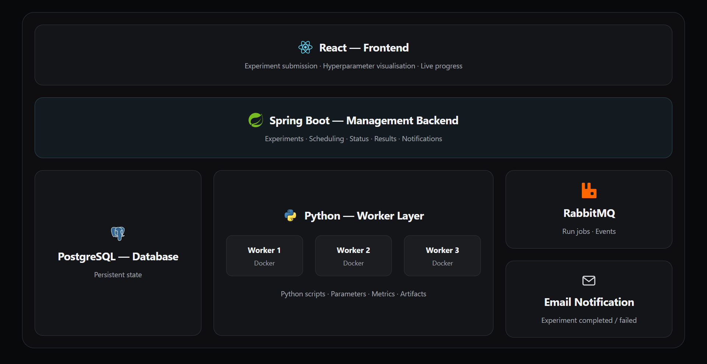

# Labyrinth

A scientific research platform for exploring hyperparameter spaces through grid search and live visualization.

Researchers submit a Python script and a hyperparameter grid. Labyrinth runs one trial per parameter combination, tracks progress through a Java Spring backend, and pushes live updates to a web frontend for monitoring and result comparison.

## Planned workflow

1. Submit a Python script and hyperparameter values.
2. Expand the grid into trials and execute them in isolated Python workers.
3. Store trial parameters, status, logs, and metrics; stream progress to the frontend.
4. When the experiment finishes, publish a completion event through RabbitMQ.
5. Future downstream services consume that event to send email or other notifications.

## Architecture



## Planned project structure

```text
labyrinth/
├── frontend/                  # React + TypeScript
├── backend/                   # Java + Spring Boot
├── worker/                    # Python
├── examples/                  # Research programs
├── contracts/                 # Shared schemas
│
├── infra/
│   ├── postgres/
│   ├── rabbitmq/
│   └── docker/
│
├── docs/
├── compose.yaml
├── .env.example
├── AGENTS.md
└── README.md
```

## Status

The project is in early development. The Spring Boot backend provides
creation and lookup for experiments, teams, users, tickets, and comments
through JPA.
Local PostgreSQL is available through Docker Compose. The backend
connects to PostgreSQL and applies Flyway schema migrations on startup.
Records are persisted in PostgreSQL. Execution, the frontend,
workers, and RabbitMQ are still planned.

## Local PostgreSQL

Requires Docker with Docker Compose. From the repository root:

```sh
cp .env.example .env
```

Set `POSTGRES_PASSWORD` in `.env` to your local development password.
If port 15432 is occupied, change `POSTGRES_PORT` in the same file.

```sh
docker compose up -d --wait postgres
```

`POSTGRES_DB` and `POSTGRES_USER` default to `labyrinth` in the example.
PostgreSQL is available on `127.0.0.1`, using `POSTGRES_PORT` (15432 in
the example). Data is stored in the `postgres_data` Docker volume.
`.env` is ignored by Git.

Open a SQL shell:

```sh
docker compose exec postgres sh -c \
  'exec psql -U "$POSTGRES_USER" -d "$POSTGRES_DB"'
```

Stop PostgreSQL while keeping its data:

```sh
docker compose down
```

Database credentials initialize a new volume only. Changing `.env`
does not update the password of an existing database. The backend
persists experiment records in PostgreSQL through Spring Data JPA.

## Run with Docker Compose

After setting up `.env`, build and start the backend and PostgreSQL:

```sh
docker compose up -d --build --wait
docker compose logs -f backend
```

Once both services are healthy, use the experiment API at
`http://localhost:8080`. The backend connects to `postgres:5432` on the
Compose network. `POSTGRES_PORT` controls the published database port
for host tools; `POSTGRES_HOST` is used when running Java locally.
PostgreSQL must be healthy before the backend starts. The backend image
runs as a non-root user.

The backend health check polls `/actuator/health`. It reports healthy
when the application and its PostgreSQL connection are available.
The endpoint returns a status without exposing component details.
Check container health with `docker compose ps`.

Rebuild after changing backend code with `docker compose up -d --build`.
Stop the stack with `docker compose down`; its database volume is kept.

The multi-stage image build compiles the application and runs Checkstyle
and Spotless checks. It skips Testcontainers tests; run
`mvn -f backend/pom.xml verify` separately with Docker available before
building the image.

## Run the backend locally

Requires Java 21, Maven, and a running PostgreSQL instance. Compose
reads `.env` automatically, but the Java application does not. Use
shell-compatible assignments in `.env`; quote values containing shell
special characters. From the repository root, export its values:

```sh
set -a
. ./.env
set +a
mvn -f backend/pom.xml spring-boot:run
```

`POSTGRES_HOST` is the database host seen by the Java process; use
`localhost` when running the backend on the host. Flyway applies
versioned migrations from `backend/src/main/resources/db/migration`.
Do not edit a migration after applying it to a persistent database;
add a new version instead.

Create an experiment:

```sh
curl -i http://localhost:8080/api/experiments \
  -H 'Content-Type: application/json' \
  -d '{"name":"Demo"}'
```

The response is HTTP 201 with the experiment data and a `Location`
header for retrieving it. See the experiment API below for details.

Build and run available tests with `mvn -f backend/pom.xml verify`.

Spring Boot DevTools is enabled for local development and is excluded
from the packaged application.

## Experiment API

`POST /api/experiments` accepts a JSON body such as `{"name":"Demo"}`.
It returns HTTP 201 with an ID, name, `PENDING` status, and a `Location`
header pointing to `GET /api/experiments/{id}`. Lookup returns HTTP 200
for an existing experiment or HTTP 404 for an unknown ID. Missing,
null, or blank names return HTTP 400.

Experiments are stored in PostgreSQL and survive backend restarts.
Flyway manages the schema; Hibernate validates it without modifying it.
Execution is still planned. Request examples
are in [experiments.http](backend/requests/experiments.http).

## Team API

`POST /api/teams` accepts a JSON body such as `{"name":"Backend"}`.
It returns HTTP 201 with the team's ID and name, and a `Location` header
pointing to `GET /api/teams/{id}`. Lookup returns HTTP 200 for an existing
team or HTTP 404 for an unknown ID. Missing, null, or blank names return
HTTP 400. Team names are not required to be unique.

Teams are persisted in PostgreSQL. Request examples are available in
[team.http](backend/requests/team.http).

## User API

`POST /api/users` accepts a name and an existing team's ID, for example
`{"name":"Researcher","teamId":1}`. It returns HTTP 201 with the user's
ID, name, and `teamId`, plus a `Location` header for `GET /api/users/{id}`.
Lookup returns HTTP 200 for an existing user or HTTP 404 for an unknown
ID. Creation with an unknown team also returns HTTP 404. Missing, null,
or blank names and missing, null, or nonpositive team IDs return HTTP 400.

Users are persisted in PostgreSQL. Request examples are available in
[user.http](backend/requests/user.http).

## Ticket API

`POST /api/tickets` accepts `title`, `content`, and `currentTeamId`.
It returns HTTP 201 with a `Location` header for `GET /api/tickets/{id}`.
The response includes the ticket's ID, title, content, `OPEN` status,
current team ID, initial version (0), and database-generated `createdAt`.
Lookup returns HTTP 200 or HTTP 404 for an unknown ticket. Creation with
an unknown team returns HTTP 404. Missing, null, or blank title/content
and missing, null, or nonpositive team IDs return HTTP 400.

Request examples are in [ticket.http](backend/requests/ticket.http).

## Comment API

`POST /api/comments` accepts `content`, `authorId`, and `ticketId`.
It returns HTTP 201 with a `Location` header for `GET /api/comments/{id}`.
The response includes the comment's ID, content, author ID, ticket ID,
and database-generated `createdAt`. Lookup returns HTTP 200 or HTTP 404
for an unknown comment. Creation with an unknown author or ticket also
returns HTTP 404. Missing, null, or blank content and missing, null, or
nonpositive author/ticket IDs return HTTP 400.

Request examples are in [comment.http](backend/requests/comment.http).

## Java formatting and lint

Spotless uses the Eclipse JDT formatter with the shared profile in
`backend/config/eclipse-formatter.xml`. It uses four spaces and wraps at
79 columns. It also sorts imports and removes unused imports.

Apply formatting:

```sh
mvn -f backend/pom.xml spotless:apply
```

Check formatting and run Checkstyle without compiling:

```sh
mvn -f backend/pom.xml spotless:check checkstyle:check
```

The lint rules are in `backend/config/checkstyle.xml`. Checkstyle runs
during Maven's `validate` phase; Spotless checks run during `verify`.
Use these commands as the source of truth for formatting.

Put a null check directly after its lookup or service call, with no blank
line in between. The formatter preserves this layout. Services return
`null` for missing records or required references, and controllers map
that result to HTTP 404. Nullable service results are documented.

## Automated tests

```sh
mvn -f backend/pom.xml verify
```

The API tests use Spring Boot and MockMvc with the real application
components. Tests require a running Docker daemon accessible to the
current user. Testcontainers starts an isolated PostgreSQL 17 instance
on a random port; no `.env` or existing database is used. Spring manages
the container lifecycle and supplies its connection details to the
test application. Flyway runs the production migrations and Hibernate
validates the resulting schema. API tests cover experiment, team, user,
ticket, and comment creation and lookup, `Location` headers with a
context path, invalid request fields and IDs, and missing records or
references. Experiment tests also cover malformed JSON. Health tests
check the Actuator endpoint.
They use returned IDs rather than assuming test execution order.

Persistence tests check generated IDs, independent records with duplicate
names, reloads through a fresh JPA persistence context, committed SQL data,
and repeat Flyway execution without data loss. Ticket and comment
service tests cover creation, lookup, missing references, persisted
relationships, and database-generated timestamps.

For a faster test-only run, use `mvn -f backend/pom.xml test`.
